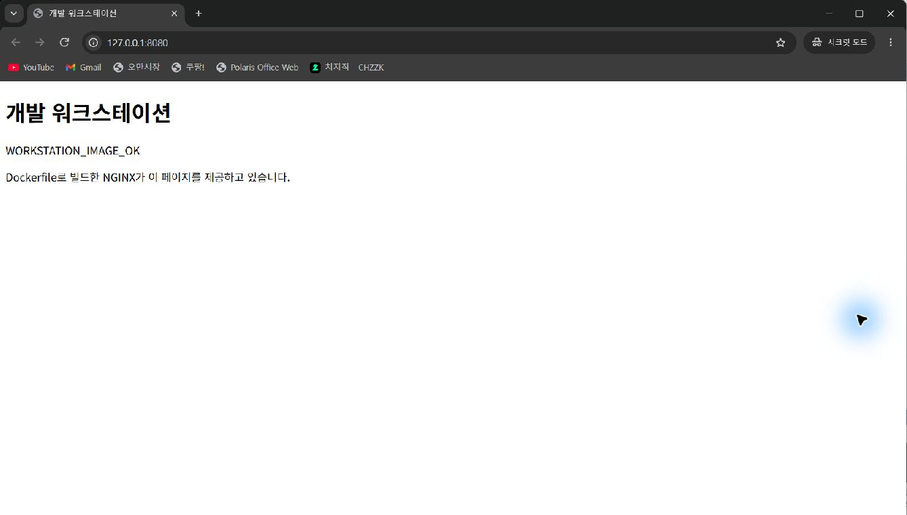
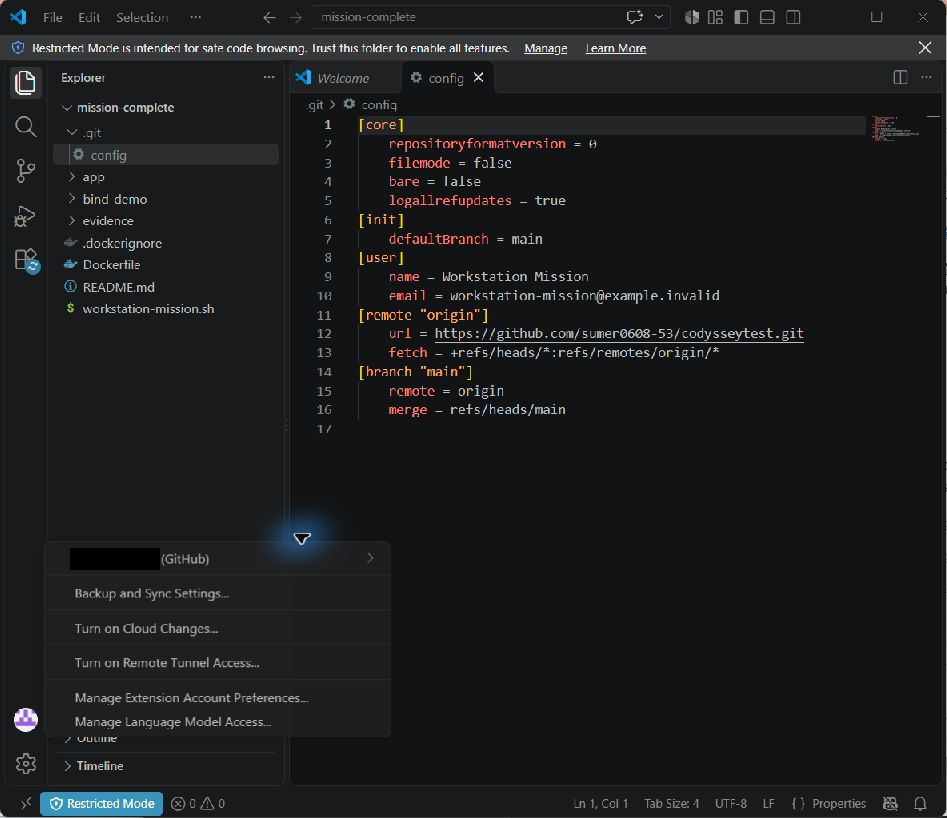

# 개발 워크스테이션 구축

터미널과 Git으로 작업 환경을 구성하고, NGINX 정적 웹 서버를 Docker 이미지로 빌드해 포트 매핑, 바인드 마운트, 볼륨 영속성을 검증했다.

## 실행 환경

- OS 및 아키텍처: Linux 6.18.58.1-microsoft-standard-WSL2 x86_64
- 셸: Bash 5.3.9(1)-release
- 터미널 정보: xterm-256color
- Docker: Docker version 29.9.2, build a82e528
- Git: git version 2.53.0

## 수행 결과

- [x] 터미널 조작과 파일·디렉터리 권한 실습
- [x] Docker 엔진 점검, hello-world, Ubuntu 내부 명령 및 컨테이너 운영
- [x] [Dockerfile](Dockerfile)과 [웹 소스](app/index.html) 빌드 및 실행
- [x] 두 포트에서 HTTP 응답 확인 (`http://127.0.0.1:18080/`, `http://127.0.0.1:18081/`)
- [x] 호스트 파일 변경 반영과 Docker 볼륨 데이터 유지 확인
- [x] 저장소 범위 Git 사용자 정보와 기본 브랜치 설정
- [x] [브라우저 주소창과 페이지 캡처](evidence/browser.jpg) (동일 Dockerfile로 재실행한 8080 포트)
- [x] [VS Code GitHub 로그인 및 원격 저장소 연동 캡처](evidence/vscode.png) (계정 메뉴의 사용자명 마스킹)
- [x] [GitHub 저장소](https://github.com/sumer0608-53/codysseytest) 연결 및 main 브랜치 푸시

[전체 명령과 출력](evidence/terminal.txt)에서 각 검증의 실제 결과를 볼 수 있다. 로그의 `<MISSION_DIR>`와 `<TEMP_DIR>`는 실행 환경의 경로를 가린 표시다.

## 제출 파일 구조

~~~text
.
├── README.md
├── Dockerfile
├── app/index.html
├── bind-demo/index.html
├── workstation-mission.sh
└── evidence/
    ├── terminal.txt
    ├── docker-diagnostics.txt
    ├── browser.jpg
    └── vscode.png
~~~

## 실행 증거

**브라우저 접속** · 같은 Dockerfile로 서버를 다시 실행해 8080 포트와 응답을 한 화면에 담았다.

**VS Code 연동** · Accounts 메뉴의 GitHub 세션과 Git 설정의 `origin` 주소를 확인했다. 계정 메뉴의 사용자명은 가렸다.

**hello-world 실행 로그 발췌**

~~~text
$ docker run --rm --name workstation-1795233686-4440-25170-hello hello-world

Hello from Docker!
This message shows that your installation appears to be working correctly.
~~~

**GitHub 원격 연결 및 푸시** · 아래는 초기 원격 연결에 사용한 명령과 첫 푸시의 실제 출력 발췌다. [GitHub 푸시 커밋](https://github.com/sumer0608-53/codysseytest/commit/b9b1e1e)

~~~text
$ git remote add origin https://github.com/sumer0608-53/codysseytest.git
$ git push -u origin main
To https://github.com/sumer0608-53/codysseytest.git
   02f5801..b9b1e1e  main -> main
branch 'main' set up to track 'origin/main'.
~~~

## 검증과 재현

Docker의 Linux 엔진을 시작하고 이 저장소의 루트에서 실행한다. Windows에서는 Docker Desktop의 WSL2 통합을 켜고 WSL2 셸에서 실행한다. macOS에서는 Docker Desktop이나 OrbStack을 사용할 수 있다. 사용 중인 호스트 포트는 다른 번호로 바꾼다.

1. `docker --version`, `docker info`, `git --version`으로 환경을 확인한다.
2. 아래 명령으로 새 폴더에서 전체 실습을 실행한다. `PORT_ONE`과 `PORT_TWO`는 호스트 포트이며 기본값은 8080과 8081이다. 명령에 `--capture`를 추가하면 서버가 실행 중일 때 증거를 첨부할 수 있다.
3. 결과 폴더의 README와 `evidence/terminal.txt`를 확인한다.

~~~bash
PORT_ONE=18080 PORT_TWO=18081 bash workstation-mission.sh
~~~

웹 서버만 확인할 때는 다음 명령을 사용한다.

~~~bash
docker build -t mission-web .
docker run --rm -d --name mission-web -p 127.0.0.1:18080:80 mission-web
curl -fsS http://127.0.0.1:18080/
docker logs mission-web
docker stats --no-stream mission-web
docker stop mission-web
docker image rm mission-web
~~~

`--rm`으로 실행한 컨테이너는 중지할 때 제거된다. 별도로 만든 컨테이너는 `docker ps -a`로 이름을 확인한 뒤 `docker stop <이름>`, `docker rm <이름>` 순서로 정리한다. 이후 해당 실습 이미지 태그를 `docker image rm <이미지:태그>`로 제거할 수 있다. 볼륨은 사용할 컨테이너가 없고 데이터가 더 이상 필요하지 않을 때 `docker volume rm <볼륨명>`으로 별도 제거한다.

Docker는 변경이 없는 빌드 레이어를 재사용한다. 캐시 없이 다시 빌드하려면 `docker build --no-cache -t mission-web .`을 사용한다. `--pull`을 추가하면 베이스 이미지의 최신 버전을 확인하며, 같은 베이스가 필요하면 Dockerfile의 태그를 다이제스트로 고정한다.

- **터미널과 권한** · `pwd`로 절대 경로를 확인했다. `notes.txt`와 같은 상대 경로는 현재 디렉터리를 기준으로 해석한다. `ls -ld`로 파일의 600→644, 디렉터리의 700→755 변경을 확인했다. 소유자·그룹·기타 사용자마다 읽기(4), 쓰기(2), 실행(1)을 더한다. 디렉터리의 실행 권한은 내부 경로에 접근하는 데 필요하다.
- **이미지와 컨테이너** · `nginx:alpine`을 베이스로 선택했다. `LABEL`로 이미지 제목을 지정했고, `COPY`로 기본 페이지를 교체했다. 이미지는 실행에 필요한 파일과 설정을 담고, 컨테이너는 그 이미지에서 격리되어 실행되는 인스턴스다.
- **컨테이너 내부 명령** · `docker exec`로 실행 중인 Ubuntu 컨테이너에서 명령을 실행하고, 해당 명령이 끝나도 컨테이너가 실행 중임을 확인했다. `docker start -a`는 주 프로세스 출력에 연결되며, 이 실습의 일회성 주 프로세스가 끝나면 컨테이너도 종료된다.
- **포트 매핑** · 두 호스트 포트에 각각 컨테이너의 80번을 연결했다. `curl`로 두 주소에서 `WORKSTATION_IMAGE_OK`를 확인했다. 주소를 127.0.0.1에 바인딩해 같은 컴퓨터의 브라우저에서 접속한다.
- **바인드 마운트** · 두 번째 포트의 컨테이너를 교체해 `bind-demo/`를 읽기 전용으로 연결했다. 호스트 파일 수정 후 같은 컨테이너에서 `BIND_BEFORE`가 `BIND_AFTER`로 바뀌었고 첫 번째 포트의 이미지 콘텐츠는 그대로 제공됐다.
- **볼륨** · 이름 있는 볼륨을 만들고 첫 컨테이너의 `/data`에 기록했다. 컨테이너를 삭제하고 같은 볼륨을 새 컨테이너에 연결한 뒤 `VOLUME_OK`를 확인했다.
- **Git과 GitHub** · Git은 로컬에서 커밋과 브랜치를 관리한다. GitHub는 원격 저장소를 호스팅해 공유와 협업을 지원한다. Git 사용자 설정은 이 저장소에만 적용했다.

### 권한·경로·이미지 선택

- 파일은 `644 = (4+2, 4, 4) = rw-r--r--`로 설정했다. 소유자가 정적 파일을 편집하고 그룹과 기타 사용자는 읽을 수 있도록 했다. HTML 파일은 실행 권한이 필요 없다.
- 디렉터리는 `755 = (4+2+1, 4+1, 4+1) = rwxr-xr-x`로 설정했다. 소유자가 항목을 관리하고 다른 사용자는 목록을 읽고 내부 경로에 접근할 수 있도록 했다.
- 바인드 마운트 대상은 NGINX가 정적 파일을 읽는 절대 경로 `/usr/share/nginx/html`이다. 컨테이너의 작업 디렉터리와 관계없이 같은 위치에 연결된다. 볼륨은 실습 데이터를 따로 관리할 수 있도록 `/data`에 마운트했다.
- `app/index.html`을 수정하고 같은 태그로 이미지를 다시 빌드해도 기존 컨테이너는 생성 시 사용한 이미지의 페이지를 계속 제공한다. 새 페이지를 제공하려면 새 이미지로 컨테이너를 다시 생성한다. 바인드 마운트한 파일은 호스트에서 수정하면 실행 중인 컨테이너에 반영된다.

### 네트워크 네임스페이스와 포트포워딩

Docker 기본 브리지 네트워크에서 컨테이너는 별개의 네트워크 네임스페이스를 사용해 인터페이스, IP 주소, 라우팅과 포트 공간을 격리한다. 따라서 두 NGINX 컨테이너는 각자 자신의 80번 포트에서 동시에 대기할 수 있다. `-p 127.0.0.1:18080:80`은 호스트의 루프백 주소 18080으로 들어온 연결을 Docker의 포트포워딩을 통해 해당 컨테이너의 80번으로 전달한다. 두 번째 컨테이너는 호스트 18081로 매핑한다. 충돌 여부는 호스트 쪽 주소와 포트를 기준으로 판단한다. [Docker 포트 공개 문서](https://docs.docker.com/engine/network/port-publishing/)

### 볼륨 상태와 백업

`docker volume ls`로 이름과 드라이버를 조회하고 `docker volume inspect <볼륨명>`으로 상세 상태를 확인한다. 보완 실습에서는 새 볼륨의 드라이버와 범위가 모두 `local`임을 확인했다. [실제 볼륨 상태 로그](evidence/docker-diagnostics.txt)

아래는 원본 볼륨을 읽기 전용으로 연결해 백업한 뒤 새 볼륨으로 복원하는 예시다. `mydata`를 실제 볼륨 이름으로 바꾸고, 일관된 백업을 위해 쓰기 중인 서비스를 먼저 중지한다.

~~~bash
docker volume inspect mydata
docker run --rm --mount type=volume,source=mydata,target=/data,readonly \
  --mount "type=bind,source=$PWD,target=/backup" ubuntu:24.04 \
  tar -czf /backup/mydata.tar.gz -C /data .
docker volume create mydata-restored
docker run --rm --mount type=volume,source=mydata-restored,target=/data \
  --mount "type=bind,source=$PWD,target=/backup,readonly" ubuntu:24.04 \
  tar -xzf /backup/mydata.tar.gz -C /data
~~~
## 트러블슈팅 재현

| 문제 | 원인 가설 | 확인 | 해결 | 증거와 검색어 |
| --- | --- | --- | --- | --- |
| 웹 요청이 404를 반환 | 요청한 파일이 웹 이미지에 없음 | `curl`로 `/missing.html`의 404 응답을 기록 | `/`로 요청하여 정적 페이지 응답 확인 | [터미널 로그](evidence/terminal.txt) · `missing.html` |
| 컨테이너 교체 후 파일을 찾을 수 없음 | `/tmp` 파일을 컨테이너의 쓰기 계층에 저장 | 새 컨테이너의 `/tmp/proof.txt` 부재 확인 | 이름 있는 볼륨을 `/data`에 재연결해 `proof.txt` 읽기 | [터미널 로그](evidence/terminal.txt) · `/tmp/proof.txt: absent`, `VOLUME_OK` |
| 호스트 포트를 게시할 수 없음 | 실행 중인 컨테이너가 같은 주소와 포트를 사용 | `docker ps`의 포트 매핑과 두 번째 실행 오류 확인 | 실습 컨테이너를 중지한 뒤 같은 포트로 다시 실행 | [Docker 진단 로그](evidence/docker-diagnostics.txt) · `18087`, `port is already allocated` |

### Docker 데몬 연결 점검

- [ ] `docker --version`으로 CLI 설치를 확인하고 `docker info`로 서버 연결을 검사한다.
- [ ] `docker context show`와 `docker context ls`로 현재 컨텍스트가 사용하려는 엔진을 가리키는지 확인한다.
- [ ] Windows에서는 Docker Desktop의 엔진이 시작됐는지와 Ubuntu의 WSL2 통합이 켜져 있는지 확인한다. macOS에서는 사용하는 Docker Desktop 또는 OrbStack을 시작한다. Linux에서 systemd로 관리하는 엔진은 `systemctl status docker`로 상태를 확인한다.
- [ ] 연결이 복구되지 않으면 사용 중인 데몬을 재시작해도 되는지 확인한 뒤 Docker Desktop 또는 OrbStack을 재시작한다. Linux에서 관리자 권한이 있는 경우 `sudo systemctl restart docker`를 사용한다. `docker info`와 `docker run --rm hello-world`를 다시 실행한다.

### 포트 충돌 진단과 해제

1. `docker ps --format '{{.Names}} {{.Ports}}'`로 해당 호스트 포트를 게시하는 컨테이너를 찾는다. WSL에서 매핑이 보이지 않으면 Windows PowerShell에서 `Get-NetTCPConnection -State Listen -LocalPort 18087`로 소유 PID를 확인한다. Linux 호스트에서는 `ss -ltnp 'sport = :18087'`로 리스너를 확인한다.
2. 소유자가 중지해도 되는 실습 컨테이너이면 `docker stop <이름>`으로 중지한 뒤 매핑을 다시 확인한다. 다른 서비스가 사용 중이면 `PORT_ONE=18088 PORT_TWO=18089 bash workstation-mission.sh`처럼 비어 있는 호스트 포트로 바꾼다.
3. 같은 포트로 다시 실행하고 `curl -fsS http://127.0.0.1:<포트>/`로 웹 응답을 확인한다. 이번 재현에서는 18087의 점유 컨테이너를 중지하고 같은 포트에서 새 컨테이너가 시작되는 것을 확인했다. [Docker 진단 로그](evidence/docker-diagnostics.txt)
